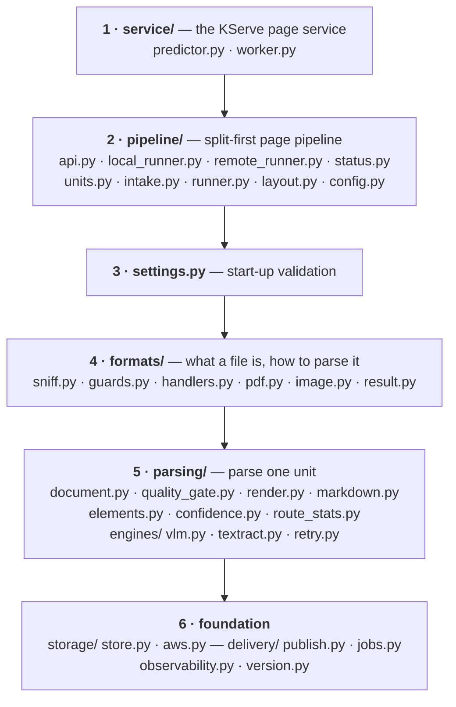
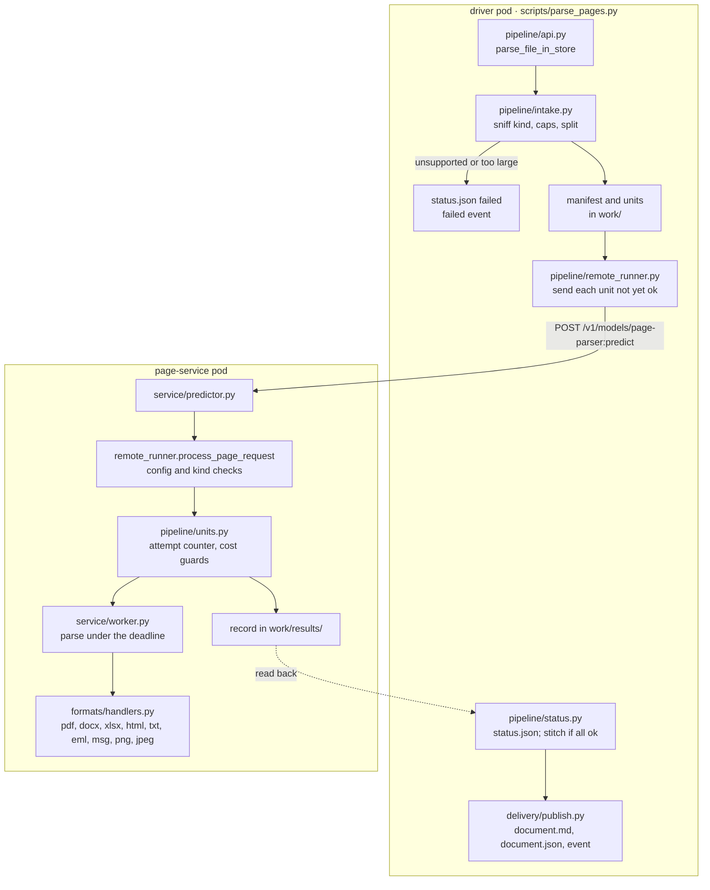
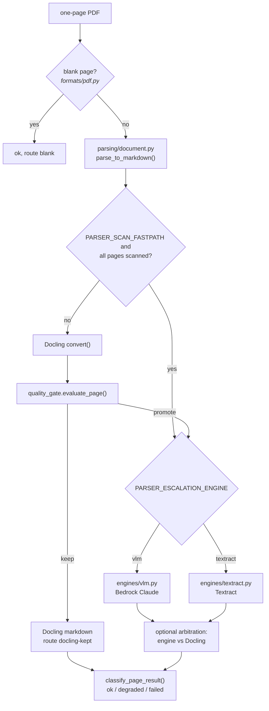

# parser_service — module architecture

How the code in `src/parser_service/` is organised: the layers and what each module
owns, how one file and one page move through it, and the rules that keep the import
graph clean. The dependencies below were computed from the actual imports: there are
no import cycles between modules or between packages.

## 1. Layers

A package imports only from the layers below it (not only the next one down).

Inside `pipeline/` the modules follow the same rule: `config` ← `layout`, `runner` ← `intake`,
`units` ← the runners and `status` ← `api`.

## 2. Modules

| Package | Module | Owns |
|---|---|---|
| `service/` | `predictor.py` | The KServe custom predictor: one unit per request; 429 busy, 503 while the worker restarts, 409 config or kind refused |
| | `worker.py` | The long-lived parse process holding the warm models; SIGKILLed and restarted at a unit's deadline |
| `pipeline/` | `api.py` | `parse_file_in_store` (old name `parse_pdf_pages_in_store`) and `parse_pdf_pages` |
| | `local_runner.py` | The `local` executor: a process pool on one machine |
| | `remote_runner.py` | The `kserve` executor: the driver's client, and the service's side of a request |
| | `status.py` | Rebuild `status.json` from the records; stitch `output.md` only when every unit is ok |
| | `units.py` | Process one unit, write its record (first write wins), archive a failed attempt for a retry |
| | `intake.py` | Sniff a file's kind, refuse it (`unsupported_type`, `too_large`), split a PDF, write the manifest |
| | `runner.py` | The contract between the pipeline and a parse runner: `Request`, `ParseRunner`, the worker errors |
| | `layout.py` | Every key under `work/` and `out/`, and the record / attempt / JSON helpers |
| | `config.py` | Unit and file states, the per-kind pipeline config and its hash, enabled kinds, caps, deadlines, the final-failure rule |
| top level | `settings.py` | Start-up validation of the environment for the scripts and the service |
| `formats/` | `sniff.py` | A file's kind from its bytes (and the extension for txt and html) |
| | `guards.py` | The cost guards: DOCX (ZIP index, streamed element count), XLSX (ZIP index, streamed cell and used-range count) and images (declared megapixels, header only) |
| | `handlers.py` | One handler per kind (pdf, docx, xlsx, html, txt, eml, msg, png, jpeg) and their versions |
| | `pdf.py` | One PDF page: blank-page probe, `parse_to_markdown`, `classify_page_result` |
| | `image.py` | One PNG or JPEG, parsed as one page: blank probe, `parse_to_markdown`, the PDF page's classification |
| | `result.py` | The unit result contract: states, `Reply`, `exception_reply`, `apply_output_cap` |
| `parsing/` | `document.py` | `parse_to_markdown`: Docling first, the quality gate, escalation, Markdown |
| | `quality_gate.py` | Keep Docling's page, or promote it to the escalation engine |
| | `render.py` | Rasterise pages, count text-layer tokens, the scan fast-path probe, fit an input image to the engines' limits |
| | `markdown.py` | Elements to Markdown |
| | `elements.py` | Docling items to eval-harness elements, the output skeleton, input size checks |
| | `confidence.py`, `route_stats.py` | Advisory confidence scores; the route vocabulary and CSV fields |
| | `engines/vlm.py`, `engines/textract.py`, `engines/retry.py` | The escalation engines (Bedrock Claude, Textract) and their bounded retry |
| `storage/` | `store.py`, `aws.py` | The store interface (local folder or S3 prefix); the S3 URI parser and client factory |
| `delivery/` | `publish.py`, `jobs.py` | Versioned `published/` documents and events; inbox jobs (`job.json`) |
| top level | `observability.py`, `version.py` | Metrics and structured events; the package version |

## 3. Runtime flow: one file

The driver pod (`scripts/parse_pages.py`, one per file) does intake and bookkeeping;
the page-service pods do all parsing and write each unit's record.

## 4. Runtime flow: one PDF page

## 5. Rules that keep the structure

- **Imports point down the layers**, between packages and between modules. There are
  no import cycles at either level.
- **Contracts live with the layer that uses them.** The pipeline defines what it
  needs from a parse runner (`pipeline/runner.py`); the service implements it. The
  unit result contract (`formats/result.py`) sits below both.
- **Function-level imports are deliberate and few.** The worker and the handlers
  import the Docling path only when they parse, so the page service's own process
  stays light (a test checks that it never loads Docling or torch).
- **Shared code has one public home.** A name used across packages is public (no
  leading underscore) and lives in the module that owns it: `formats/result.py`,
  `pipeline/runner.py`, `parsing/elements.py`, `storage/aws.py`, `version.py`. Inside
  `pipeline/`, the modules also share package-private helpers (`_run_pages`,
  `_stitch_markdown`, ...), which nothing outside the package imports.
- **Tests patch a name where it is looked up.** Patch the module that defines it. The
  one name patched across modules, `pipeline.layout._load_record_checked`, is called as
  `layout._load_record_checked` from the other pipeline modules, so the patch reaches
  every caller.
