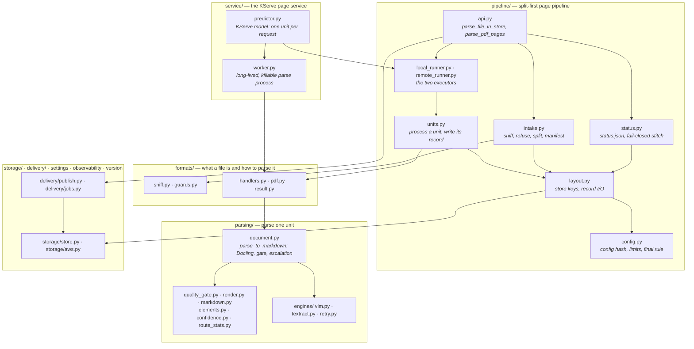
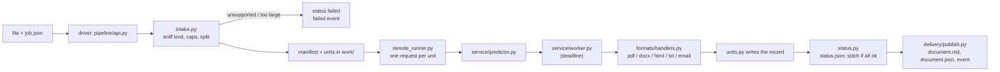
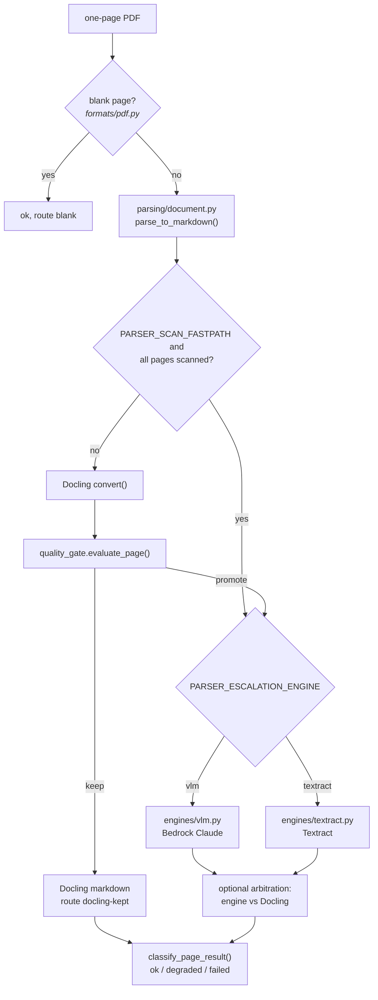

# parser_service — module architecture

How the code in `src/parser_service/` is organised: the layers and what each module
owns, how one file and one page move through it, and the rules that keep the import
graph clean. Edges were traced from the actual imports; the package has no import
cycles.

## 1. Layers

Each layer imports only from the layers below it.

`legacy/` sits beside these layers: the element-JSON `parse()` for the eval harness
(`legacy/element_json.py`, exposed as `parser_service.parse` and imported only when first
used) and the single-node batch script's I/O (`legacy/batch_io.py`).

## 2. Modules

| Package | Module | Owns |
|---|---|---|
| `service/` | `predictor.py` | The KServe custom predictor: one unit per request; 429 busy, 503 while the worker restarts, 409 config or kind refused |
| | `worker.py` | The long-lived parse process holding the warm models; SIGKILLed and restarted at a unit's deadline |
| `pipeline/` | `api.py` | `parse_file_in_store` (old name `parse_pdf_pages_in_store`) and `parse_pdf_pages` |
| | `local_runner.py` | The `local` executor: a process pool on one machine |
| | `remote_runner.py` | The `kserve` executor: the driver's client, and the service's side of a request |
| | `units.py` | Process one unit, write its record (first write wins), archive a failed attempt for a retry |
| | `status.py` | Rebuild `status.json` from the records; stitch `output.md` only when every unit is ok |
| | `intake.py` | Sniff a file's kind, refuse it (`unsupported_type`, `too_large`), split a PDF, write the manifest |
| | `layout.py` | Every key under `work/` and `out/`, and the record / attempt / JSON helpers |
| | `config.py` | Unit and file states, the per-kind pipeline config and its hash, enabled kinds, caps, deadlines, the final-failure rule |
| `formats/` | `sniff.py` | A file's kind from its bytes (and the extension for txt and html) |
| | `guards.py` | The DOCX cost guards: ZIP index and streamed element count |
| | `handlers.py` | One handler per kind (pdf, docx, html, txt, eml, msg) and their versions |
| | `pdf.py` | One PDF page: blank-page probe, `parse_to_markdown`, `classify_page_result` |
| | `result.py` | The unit result contract: states, `Reply`, `exception_reply`, `apply_output_cap` |
| `parsing/` | `document.py` | `parse_to_markdown`: Docling first, the quality gate, escalation, Markdown |
| | `quality_gate.py` | Keep Docling's page, or promote it to the escalation engine |
| | `render.py` | Rasterise pages, count text-layer tokens, the scan fast-path probe |
| | `markdown.py` | Elements to Markdown |
| | `elements.py` | Docling items to eval-harness elements, the output skeleton, input size checks |
| | `confidence.py`, `route_stats.py` | Advisory confidence scores; the route vocabulary and CSV fields |
| | `engines/vlm.py`, `engines/textract.py`, `engines/retry.py` | The escalation engines (Bedrock Claude, Textract) and their bounded retry |
| `storage/` | `store.py`, `aws.py` | The store interface (local folder or S3 prefix); the S3 URI parser and client factory |
| `delivery/` | `publish.py`, `jobs.py` | Versioned `published/` documents and events; inbox jobs (`job.json`) |
| top level | `settings.py`, `observability.py`, `version.py` | Start-up validation of the environment; metrics and structured events; the package version |

## 3. Runtime flow: one file

## 4. Runtime flow: one PDF page

## 5. Rules that keep the structure

- **Imports point down the layers**, and the package has no import cycles.
- **Function-level imports are deliberate and few.** `parser_service.parse` loads the
  legacy parser on first use. The worker and the handlers import the Docling path
  only when they parse, so the page service's own process stays light (a test checks
  that it never loads Docling or torch). The legacy parser keeps its own.
- **Shared code has one public home.** A name used across packages is public (no
  leading underscore) and lives in the module that owns it: `formats/result.py`,
  `parsing/elements.py`, `storage/aws.py`, `version.py`. Inside `pipeline/`, the
  modules also share package-private helpers (`_run_pages`, `_stitch_markdown`, ...),
  which nothing outside the package should import.
- **Tests patch a name where it is looked up.** Patch the module that defines it. The
  one name patched across modules, `pipeline.layout._load_record_checked`, is called as
  `layout._load_record_checked` from the other pipeline modules, so the patch reaches
  every caller.
