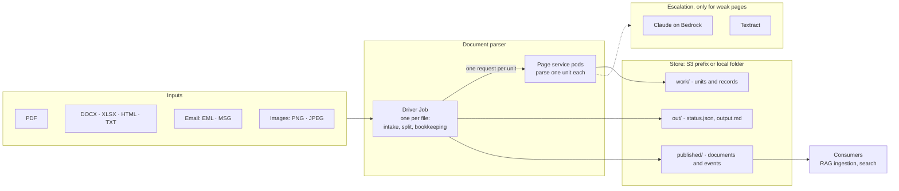
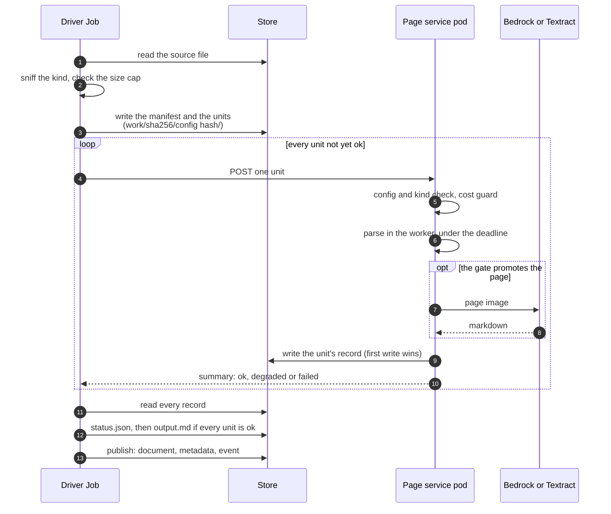
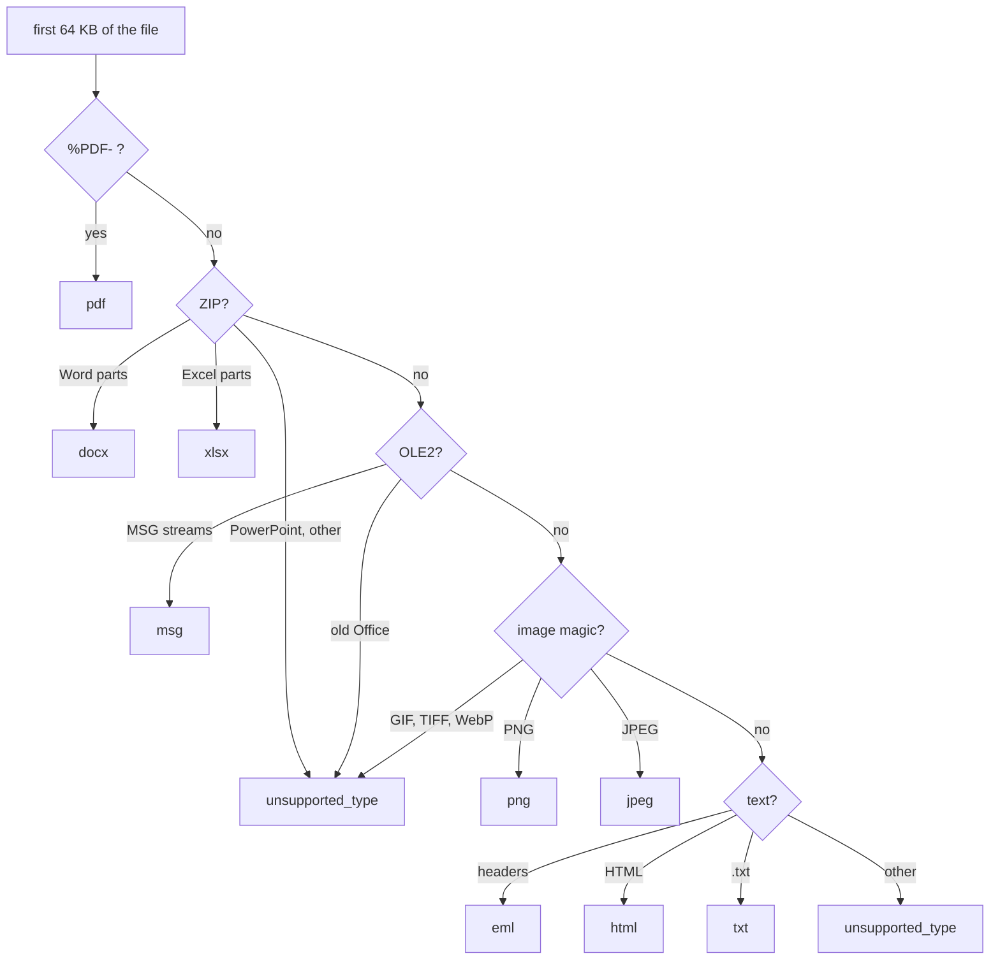
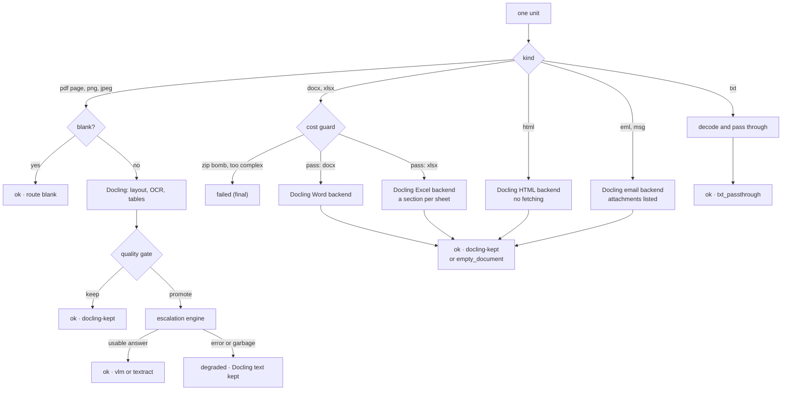
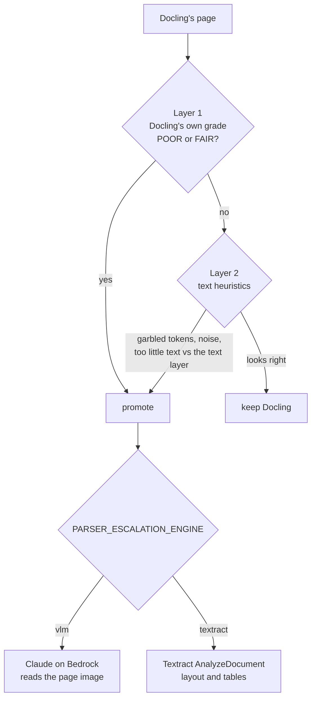
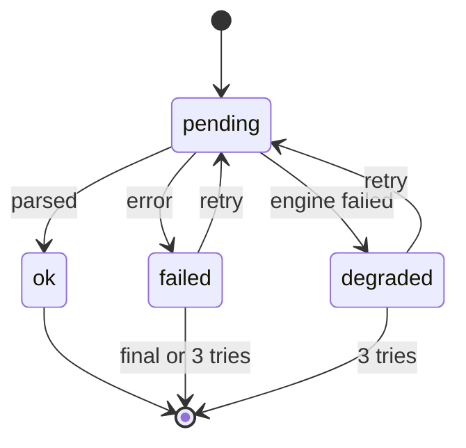
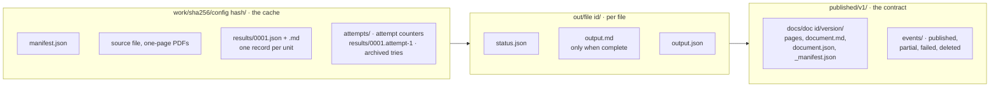
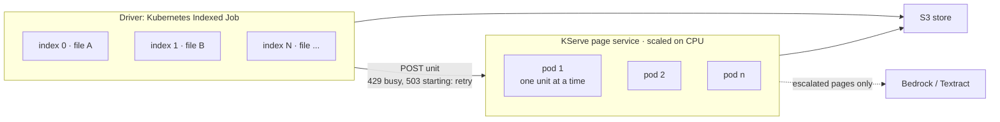

# How document parsing works

**Who should read this:** engineers new to the parser, engineers who consume its
markdown, and anyone reviewing the design. For the module map see
[architecture.md](architecture.md); for every S3 key, see
[s3-layout-design.md](s3-layout-design.md).

## In one minute

The parser turns a document into **one clean Markdown file** for search and RAG.

- **Nine file types:** PDF, DOCX, XLSX, HTML, TXT, email (EML and MSG), PNG and JPEG. The
  file's bytes decide its type, not its name. Anything else is refused as
  `unsupported_type`.
- **Split first.** A PDF is split into one-page PDFs and every page is parsed on its
  own. Every other file is parsed as one unit.
- **Docling first, escalation second.** Docling parses every page. A quality gate
  sends only the pages Docling handles badly (scans, garbled or missing text) to an
  escalation engine: Claude on AWS Bedrock, or AWS Textract.
- **Every unit leaves a record** in the store. A rerun skips the work already done
  and retries the rest, up to 3 attempts.
- **Fail closed.** The document is stitched and published only when every unit is
  `ok`. A failure never produces a half document by accident.
- **In production,** a driver Job does the bookkeeping for each file and a KServe
  page service, which scales out in pods, does all the parsing.

On the doc-bench benchmark (2026-10-15) the page pipeline scores the same as parsing
each file whole, and every document takes the same route.

## The big picture

## What goes in

The kind is decided from the file's first bytes (`formats/sniff.py`). A name or a
declared content type that disagrees with the bytes is logged as a mismatch, but the
bytes win. For text and HTML, which have no magic bytes, the extension or content
type chooses between the two.

| Kind | Detected by | Unit | How it is parsed |
|---|---|---|---|
| `pdf` | `%PDF-` in the first 1 KB | **one page** | Docling, quality gate, escalation when needed |
| `png`, `jpeg` | PNG or JPEG magic | one image | Like a scanned PDF page: Docling OCR, gate, escalation |
| `docx` | ZIP whose parts say Word | whole document | Docling Word backend, after the DOCX cost guard |
| `xlsx` | ZIP whose parts say Excel (`.xlsx`, `.xlsm`) | whole workbook | Docling Excel backend, after the XLSX cost guard; one section per sheet |
| `html` | text with an HTML marker, `.html`/`.htm` | whole document | Docling HTML backend; nothing is fetched |
| `txt` | plain text, `.txt` | whole document | Passed through without Docling |
| `eml`, `msg` | email headers; OLE2 with MSG streams | whole document | Docling email backend; attachments listed, never parsed |
| anything else | PPTX, legacy XLS/DOC, GIF, TIFF, ZIP, ... | — | Refused: `unsupported_type` |

`PARSER_ENABLED_KINDS` lists the kinds intake accepts (default: all nine). Removing a
kind from it is the kill switch for that kind.

## One file, step by step

1. **Intake** (driver). Sniff the kind, refuse it if no enabled kind handles it or it
   is over its kind's size cap, and hash the bytes.
2. **Split** (driver). A PDF becomes `pages/0001.pdf`, `0002.pdf`, ...; any other file
   is stored once as `source.<ext>`. A manifest records the kind, the page count and
   the pipeline config.
3. **Parse** (page service). Each unit is sent as one request; each pod parses one
   unit at a time and writes the unit's **record**: state, markdown, route, timing,
   engine call counts and warnings.
4. **Status and stitch** (driver). `status.json` is rebuilt from the records. When
   every unit is `ok`, the pages are joined into `output.md` with a page marker before
   each.
5. **Publish** (driver, when asked). A new immutable version under `published/v1/`,
   with its `_manifest.json` written last and an event: `published`, `partial`,
   `failed` or `deleted`.

## Deciding the kind

Text that is not an email becomes `html` or `txt` from its extension or declared
content type; any other name gives no kind. Binary content no rule matches is
refused.

## Parsing one unit

Each kind has one handler (`formats/handlers.py`). The handler runs in the page
service's **parse worker**, a long-lived process that keeps Docling's models loaded.

Details by kind:

- **PDF page.** A page with no text layer that renders almost white is `ok` straight
  away (route `blank`). Otherwise Docling parses it, the quality gate decides, and the
  result is `ok`, `degraded` or `failed`.
- **PNG and JPEG.** Parsed exactly like a scanned PDF page: blank probe, Docling OCR,
  gate, escalation. Before that, the page service reads the image header and refuses
  one that declares more than 50 megapixels (`too_complex`) without decoding it.
  Decoding costs about 27 MB of worker memory per megapixel.
- **DOCX.** Before Docling sees it, the cost guard reads the ZIP index (`zip_bomb` when
  it expands too far) and streams `word/document.xml` counting paragraphs and table
  cells (`too_complex` when there are too many). Embedded images are not OCRed; a large
  one sets the `images_not_ocrd` flag.
- **XLSX.** Docling loads the whole workbook, so the cost guard first runs the same ZIP
  checks as for a DOCX, then streams the worksheets counting cells and reading each
  cell's reference. Over 500,000 cells, or used ranges (rows x columns of each sheet)
  adding up to over 5 million, is `too_complex`. Measured: about 2.7 KB of memory per
  cell and 0.2 KB per used-range cell; two cells at A1 and XFD1048576 never finish
  without the guard. Each visible sheet with content becomes a `## <sheet name>`
  section. Formulas give the value Excel stored; a file saved without calculating has
  none, and the flag `formulas_not_calculated` says so. Hidden sheets are left out
  (flag `hidden_sheets_skipped`), charts are kept as their data, a lone cell (a note)
  is text rather than a one-cell table, and macros are never run.
- **HTML.** Docling's HTML backend with every fetch turned off: no remote or local
  resource is loaded.
- **Email.** Headers (From, To, Cc, Date, Subject), the body (the plain-text part when
  there is one), then one line per attachment with its name and type. Attachments,
  including attached emails, are never parsed.
- **TXT.** Never touches Docling. Decoded as UTF-8, then cp1252, then a detected
  charset, then latin-1; line endings are normalised and NUL bytes dropped.

## The quality gate and escalation

Docling is fast and good on most pages, but it can be confidently wrong on scans and
it can silently miss text. The gate (`parsing/quality_gate.py`) decides per page:

- **One engine per deployment,** set by `PARSER_ESCALATION_ENGINE` (`vlm` by default).
  On the benchmark neither wins everywhere: Claude is better on scanned forms, Textract
  on figure-heavy pages.
- **Few pages escalate:** about 1 in 5 on the benchmark set, so most pages cost no
  engine call.
- **Routes** record what happened to each page: `docling-kept`, `vlm`, `textract`,
  `vlm-fallback-docling` / `textract-fallback-docling` (the engine failed and Docling's
  text was kept: `degraded`), and `blank`, `txt_passthrough`, `empty_document`.
- **Images sent to Claude** stay unchanged when they fit Bedrock's limits (3.75 MB, 8000
  px a side); otherwise they are turned upright from their EXIF orientation and shrunk
  until they fit.
- **Optional, off by default:** a scan fast-path that skips Docling on fully scanned
  PDFs, and arbitration that keeps Docling's text when it beats the engine's.

## States, retries and failures

Every unit ends with a record in one of three states; until then it is `pending`.

- **`degraded`** means the gate promoted the page and the engine failed, so Docling's
  text was kept; **`failed`** means an error, a timeout or a guard rejection. Both are
  retried on a rerun unless the failure is final (below) or 3 attempts are used.
- **The file's state** follows from its units: `complete` when every unit is `ok`,
  `in_progress` while any is `pending`, otherwise `failed`.
- **Reruns resume.** Rerunning a file skips `ok` units, archives the failed attempt of
  any other unit, and parses it again, up to 3 attempts per unit
  (`PARSER_PAGE_MAX_ATTEMPTS`). Kubernetes reruns a failed driver up to twice.
- **Final failures are not retried**, because the same input would fail the same way:

| Reason | Meaning | Released when |
|---|---|---|
| `unsupported_type` | No enabled kind handles the file | the kind is enabled |
| `too_large` | Over the kind's raw size cap (refused at intake) | the cap is raised |
| `zip_bomb` | A DOCX's or XLSX's ZIP index expands too far | a ZIP limit is raised |
| `too_complex` | Too many DOCX paragraphs or table cells, XLSX cells or used-range area, or image megapixels | that limit is raised |
| `timeout` | The unit ran past its deadline | the deadline is raised |
| `output_too_large` | A document's markdown is over 20 MB | the output cap is raised |

Each final record stores the limits it failed under; raising a limit releases it to be
parsed again. Everything else (a Docling error, a worker crash, an engine failure) is
retried.

## What comes out

- **`work/` is keyed by content and config:** the SHA-256 of the bytes, then a hash of
  the settings that change the output (parser and Docling versions, the handler
  version, and for PDFs and images the engine and model). The same bytes under another
  name reuse the work; a config change parses into a new folder and never mixes with
  the old results.
- **`out/<file id>/`** is per source file: `status.json` (written last), `output.md` with
  a `==== page N ===` marker before each unit, and `output.json` (its metadata).
- **`published/`** is the only area consumers read. A version is immutable, its
  `_manifest.json` is written last, and an event announces it. A failed document can
  be published as `partial` (with gap markers) only when the request asks for it.

## Running in the cluster

- **The driver** (`scripts/parse_pages.py`) is a Kubernetes Indexed Job: one index per
  file of a bundle or an inbox job (`job.json`). It holds the queue: it sends each unit
  and keeps sending while pods are busy.
- **The page service** is a KServe InferenceService. Each pod admits **one unit at a
  time** and answers others with 429; the HorizontalPodAutoscaler adds pods on CPU.
- **Deadlines are enforced by killing the worker.** At the unit's deadline (600 s for a
  PDF page or an image, 60-300 s for the other kinds) the worker's process group is
  killed, a final `timeout` record is written, and a fresh worker starts with the
  models reloaded.
- **Answers the driver acts on:**

| HTTP | Meaning | Driver does |
|---|---|---|
| 200 | parsed; the record is written | moves on |
| 429 | the pod is parsing another unit | waits and resends; no attempt used |
| 503 | the worker is starting or restarting | waits and resends; no attempt used |
| 409 | config hash or kind does not match this service | stops: the deployment is inconsistent |
| 500 | the worker died; no record | reads the store, resends under the attempt limit |

- **Bedrock is not the bottleneck.** A pod makes at most one engine call at a time and
  only for escalated pages. The account's quota (6 million tokens and 10,000 requests
  per minute for Sonnet 4.6) allows roughly 50-100 calls in flight, so dozens of pods
  stay well inside it.
- **AWS region:** Bedrock and Textract work only in `ap-southeast-2` for this account.

## Limits

All are environment settings in the `parser-config` ConfigMap, checked at start-up by
both the driver and the service. Values marked * are provisional until the corpus
inventory (`scripts/corpus_inventory.py`) measures the real document mix.

| Limit | Default | Applies to |
|---|---|---|
| Deadline | 600 s * | a PDF page; an image |
| Deadline | 300 s * / 300 s * / 300 s * / 120 s * / 60 s * | DOCX / XLSX / HTML / email / TXT document |
| Raw size cap | 100 MB * | DOCX |
| Raw size cap | 50 MB * | XLSX, HTML, TXT, email, image |
| Image megapixels | 50 * | PNG, JPEG (header only) |
| DOCX guard | 300 MB expanded, 100:1 ratio, 10,000 entries, 50,000 paragraphs, 100,000 cells * | DOCX |
| XLSX guard | the same ZIP limits, 500,000 cells, 5,000,000 used-range cells * | XLSX |
| Output cap | 20 MB * | one document's markdown (not PDF pages) |
| Attempts | 3 | every unit |

## Watching it run

- **Metrics** (page service, Prometheus): units by kind, state and reason; guard
  rejections; timeouts; worker restarts; flags; parse seconds.
- **Events** (driver, structured log lines): file intake, guard rejections and file
  done, from which the driver's counters are derived.
- **No document text** is ever written to a log: only counts, codes and limits.

## Measuring quality

`scripts/run_benchmark_pages.sh` runs the doc-bench bundled set (5 dp_bench, 5
OmniDocBench, 1 scanned form) through the page pipeline with both engines and grades
it with NED (text similarity) and TEDS (table structure). It runs on one machine with
no cluster; the only remote calls are the engine's. See
[EVAL_RUNBOOK.md](../EVAL_RUNBOOK.md).

| Dataset | Engine | NED | TEDS |
|---|---|---|---|
| dp_bench | vlm / textract | 0.837 / 0.965 | 0 / 0 |
| omnidocbench | vlm / textract | 0.711 / 0.696 | 0.243 / 0.280 |
| ato_bench (scanned form) | vlm / textract | 0.670 / 0.519 | 0 / 0 |

Results from 2026-10-15. They match parsing each file whole, apart from one chart page
where Claude's answer varies from run to run.

## Known gaps

- **Long VLM replies are cut off.** Claude's reply is capped at 8,192 tokens; on a
  very dense page the JSON is cut off, the page is `degraded`, and the document is not
  published.
- **`degraded` blocks delivery.** One page whose engine call failed holds back the
  whole document. Publishing with the page flagged instead is a product decision.
- **The * limits are provisional** until the corpus inventory runs on the real corpus.
